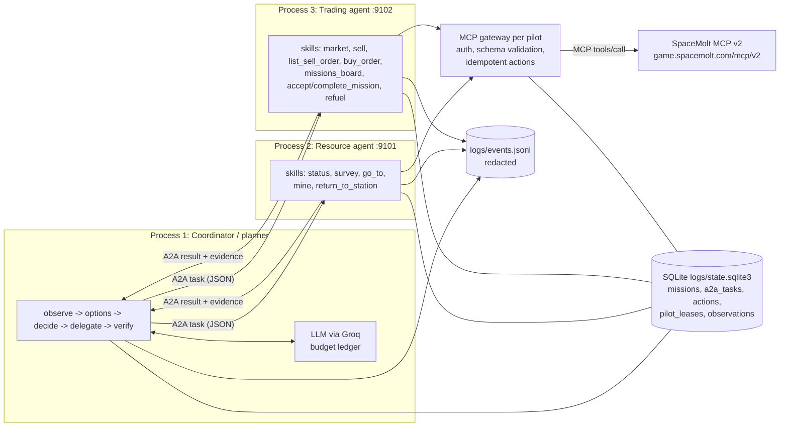

# SpaceMolt Autonomous Enterprise — Multi-Agent System

Agentic AI (FAST-NUCES Islamabad), SpaceMolt seven-day MAS assignment.
Group: `AI26-G100` · Pilots: `AI26-G100-A`, `AI26-G100-B` (Nebula) · Profiles:
https://spacemolt.com/player/AI26-G100-A and https://spacemolt.com/player/AI26-G100-B

| Member | Reg. no. | Pilot |
|---|---|---|
| Ahmed Khan | 25i-7633 | AI26-G100-A |
| Ejaz ul Haq | 25i-7624 | AI26-G100-B |

> `G100` was used because no group number had been assigned when the pilots had to be created.

The starter's original instructions are kept in [README_START_HERE.md](README_START_HERE.md).
AI coding assistant disclosure: Claude (Anthropic) was used to help write this code; both members can explain every module.

## Architecture



| Module | Role |
|---|---|
| `mas/coordinator.py` | Planner agent (own process). Builds a menu of safe, validated options from fresh observations; forced rules; the LLM picks one option + rationale; delegates over A2A; verifies evidence; restart recovery. |
| `mas/llm.py` | Groq client inside the shared budget (`scripts/budget.py`: 300 req, 250k tokens, 2/min). |
| `mas/worker.py` | A2A server framework for workers: validation, task dedupe, pilot leases, evidence, startup recovery. |
| `mas/resource_skills.py`, `mas/trading_skills.py` | What each worker can do in the game; safety rules (no smuggling/combat, `min_price`, `max_spend`). |
| `mas/a2a_protocol.py`, `mas/a2a_client.py` | JSON task/result format; non-blocking A2A send + poll. |
| `mas/mcp_gateway.py` | The only code that talks to the game: login/re-login, schema validation, idempotency ledger, reconciliation of lost replies, pacing (1 action per 10 s tick). |
| `mas/store.py` | Shared SQLite state; mission state machine; leases; stale-observation checks. |
| `mas/parsers.py`, `mas/action_params.py` | Parse the game's text replies; per-action parameters confirmed by the server. |
| `baseline/single_agent.py` | Baseline: one process, no A2A, no LLM, fixed script. |
| `mas/report.py` | Run summary / baseline comparison table from recorded evidence. |
| `mas/explore_cli.py`, `mas/send_task.py`, `mas/gateway_smoke.py` | Manual tools (practice pilots only). |

### How a decision flows (example)
1. Coordinator sees `First Cargo` active (0/15 copper) and belt `Copper Ore 10` (observation 20 s old).
2. Options: `mine_for:<mission>` (score 70), `mine` (30). LLM answers
   `{"choice":"mine_for:…","rationale":"mission needs 15 copper, belt has 10 …"}`.
3. Mission `M-…` recorded (`decided_by=llm`, rationale) → task `M-…:mine:1` sent over A2A to the resource agent.
4. Resource agent takes the pilot lease and calls MCP `spacemolt mine` repeatedly (ledger keys `M-…:mine:1:mine:0..n`).
5. Result + evidence (cargo before/after) returned; coordinator verifies cargo increased → mission `done`.

## Setup

Python 3.11+.

**Linux / macOS**
```bash
python3 -m venv .venv && source .venv/bin/activate
python -m pip install -r requirements.txt
python -m scripts.verify_local && python -m tests.run_all
```
**Windows (Anaconda Prompt / CMD)**
```cmd
py -3.11 -m venv .venv
.venv\Scripts\activate
python -m pip install -r requirements.txt
python -m scripts.verify_local
python -m tests.run_all
```

### Secrets (never committed, never logged)
- **Pilot passwords:** stored in the OS keyring (Windows Credential Manager / Secret Service) by
  `python -m mas.explore_cli` → `register <name> nebula` or `savepw <name>`. Fallback: `.secrets/` (git-ignored, chmod 600).
- **Groq key:** environment variable only. Linux: `read -s GROQ_API_KEY && export GROQ_API_KEY` ·
  Windows: `set /p GROQ_API_KEY=Enter key:` (hide the screen while typing).
- Logs are redacted (`password`, `session_id`, `token`, Groq keys) — see `tests/test_gateway.py`.

### Configuration
`cp config/mission.example.json config/mission.json` (Windows: `copy`) and set `pilots`.
Targets and safety limits (spend caps, min fuel, max active missions, LLM calls per run) live there.

## Running

Three terminals (activate `.venv` in each):
```bash
python -m mas.worker --role resource --port 9101
python -m mas.worker --role trading --port 9102
python -m mas.coordinator --config config/mission.json
```
Assessed runs: `python -m scripts.runtime start` before and `python -m scripts.runtime stop` after (8 h cap).
LLM usage so far: `python scripts/budget.py`.

Useful extras: `--rounds N` (stop after N decisions per pilot), `--no-llm` (deterministic decisions only).

## Testing and evidence
- Offline: `python -m tests.run_all` (fake game + fake LLM; covers duplicates, lost replies, restarts, A2A over HTTP).
- Live read-only check: `python -m mas.gateway_smoke --pilot <practice pilot>`.
- Failure drills and baseline procedure: [docs/DRILLS.md](docs/DRILLS.md).
- Run summary / comparison: `python -m mas.report --pilot <p> --since <t0> --until <t1>`.
- Game knowledge gathered while building: [docs/game_notes.md](docs/game_notes.md), command contracts in `docs/api_contracts/`.
